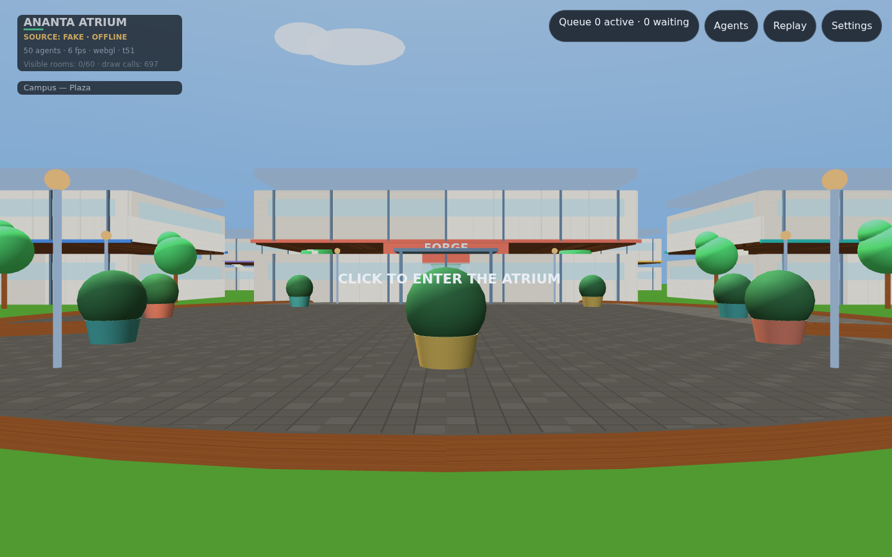
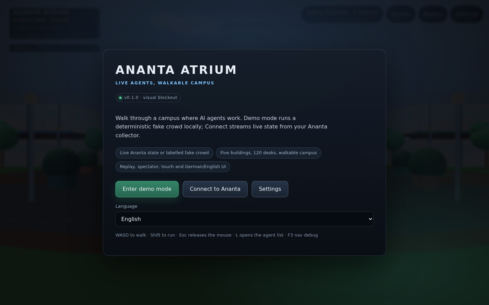
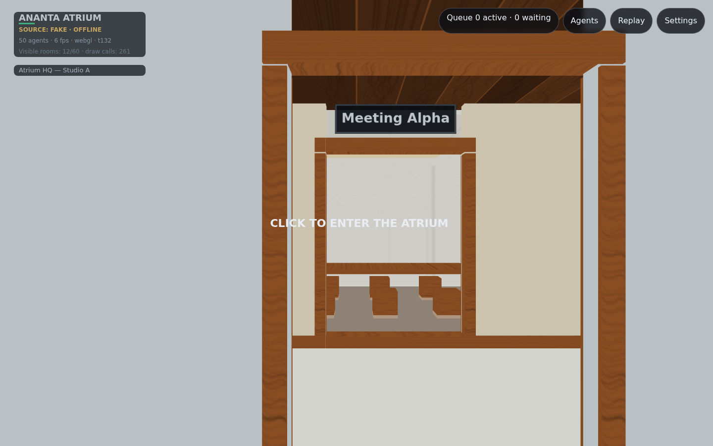
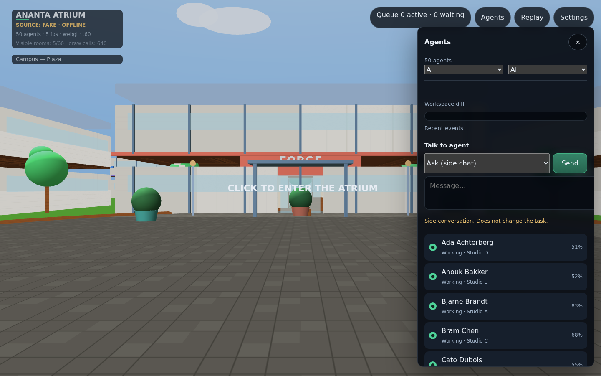

# Ananta Atrium

A first-person, browser-based 3D campus where **live AI agents** work. Five
two-storey buildings, 120 desks and a walkable plaza are driven by the local
[Ananta](https://github.com/ananta888/ananta) stack — with a deterministic,
clearly labelled fake source for development.



**Play the current build:** https://www.ananta.de/ananta-atrium/

## Quick start

```bash
npm install
npm run dev            # http://127.0.0.1:5173
```

Choose **demo mode** to walk the labelled fake crowd, or **connect to Ananta**
to point the client at a running collector. `WASD` walks, `Shift` runs, `Esc`
releases the mouse, `L` opens the agent list, `R` the replay bar, `F3` the nav
debug overlay.

```bash
npm run collector:dev  # http://127.0.0.1:8787/health
```

Live mode needs `ATRIUM_SOURCE=live`, `ATRIUM_HUB_URL` and `ATRIUM_HUB_TOKEN`
(or `_FILE`). See [`docs/integration-ananta.md`](docs/integration-ananta.md).

## Features

- **Walkable campus** — five buildings, stairs, rooms, plaza, trees and outdoor
  paths; pointer-lock controller with gravity, collisions and analytic stairs.
- **Live simulation** — deterministic 30 Hz tick, seeded RNG, desk/room
  assignment, waypoint navigation, walking agents, staleness and offline states.
- **Agent visuals** — procedural avatars with gait, typing pose, status beacons,
  distance LOD and colour-blind-safe palette.
- **Live data** — Ananta hub adapter, llama.cpp throughput, WebSocket
  snapshot/deltas, health endpoint, reconnect and a labelled 2 s fake fallback.
- **Product shell** — main menu and connect flow, persisted settings, agent list
  with filters, minimap, replay recorder/scrubber, spectator mode, touch
  controls, German/English UI, reduced motion.
- **Performance** — room-portal culling (51–79% fewer draw calls), visibility
  streaming, projected-light probe approximation, committed perf baseline and a
  CI regression gate.

| Menu | Office | Agents |
|---|---|---|
|  |  |  |

## Status

| Area | State |
|---|---|
| M0 foundation, controller, fake agents, HUD | done, unit + e2e tested |
| M1 contract, collector, Ananta/llama adapters, WS, fallback | done; live hub acceptance needs a token |
| M2 two-storey building, stairs, rooms, culling, inspection | done |
| M3 campus, streaming, LOD, 50 agents, stitching | done; reference-GPU numbers pending |
| M4 menu, settings, audio, a11y, localisation, release, CI | done |
| M5 stretch: replay, spectator, touch | done |

The live Ananta run is the one acceptance path that cannot be automated without
credentials; the checklist is in
[`docs/manual-live-checklist.md`](docs/manual-live-checklist.md).

## Scripts

| Command | Purpose |
|---|---|
| `npm run dev` | Vite dev server |
| `npm run build` | boundary check + typecheck + static build |
| `npm test` / `npm run e2e` | Vitest / Playwright |
| `npm run collector:dev` | collector (fake by default) |
| `npm run perf` / `npm run perf:update` | regression check / new baseline |
| `npm run check:assets` | manifest, licences and hashes |
| `npm run check:i18n` | locale parity and no literal UI strings |
| `npm run screenshots` | regenerate README images |
| `npm run release:check -- v0.1.0` | tag/changelog/version check |

## Documentation

- [`AGENTS.md`](AGENTS.md) — architecture rules and the todo contract.
- [`docs/architecture.md`](docs/architecture.md) — layers, determinism, ECS.
- [`docs/integration-ananta.md`](docs/integration-ananta.md) — hub endpoints/auth.
- [`docs/perf-baseline.md`](docs/perf-baseline.md) — measured budgets.
- [`docs/campus.md`](docs/campus.md) · [`docs/lod.md`](docs/lod.md) ·
  [`docs/accessibility-checklist.md`](docs/accessibility-checklist.md).
- ADRs in [`docs/adr/`](docs/adr/).

## Licence

BSD-3-Clause. No third-party art assets; all geometry, materials and audio are
procedural. See [`LICENSE`](LICENSE) and [`ATTRIBUTION.md`](ATTRIBUTION.md).
